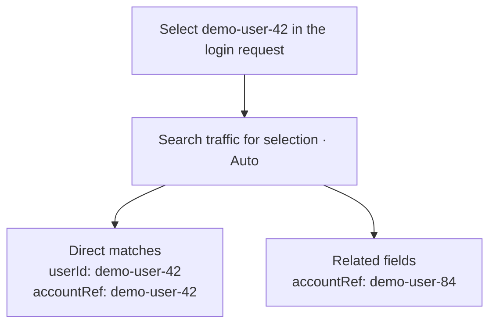

# HTTP Traffic Workbench

**v1.2.0** · [GitHub releases](https://github.com/WhileEndless/http-traffic-workbench/releases) · [WhileEndless](https://github.com/WhileEndless)

**What value did this field have for another user?** Select a value in a Burp request or response and choose **Search traffic for selection**. HTTP Traffic Workbench finds where that value appeared and surfaces comparable values already observed in other exchanges.

## Follow a value through captured traffic

Suppose a login request contains `username=demo-user-42`. Select `demo-user-42` and search in **Auto** mode. **Direct matches** show the same value under `userId` in a JSON response and under `accountRef` in other captured traffic. Open **Related fields** to see a comparable value, `demo-user-84`, observed under `accountRef` in a different exchange.



Select any result to inspect the original request and response. The search runs locally over the Burp sources you select and generates no HTTP requests.

## What it does

- **Search across formats.** Search field names, values, or plain text across query parameters, headers, cookies, forms, JSON, XML, HTML, and JavaScript. Auto uses the selected message for context and ranks exact matches above comparable values.
- **Search the sources you select.** Use Proxy history, Target Site Map, Scanner issue evidence, supported Organizer items, and imported traffic. Enable capture to include new traffic from tools such as Scanner, Repeater, Intruder, and extensions. Older Logger traffic can be added from selected messages or a Logger CSV export.
- **Track users by session.** Select a login exchange, choose where to read the user identifier, and pick the session cookie. Preview which Proxy history records would receive the user label. Save the rule to the project or export it for another project. Search also works without user labels.
- **Find captured users.** Open **Users** to search labels found in Proxy notes and the archive. Select a user to browse their traffic, or use **User filter** from a search.

## Install

1. Download `http-traffic-workbench.jar` from [GitHub Releases](https://github.com/WhileEndless/http-traffic-workbench/releases), or build the JAR from this checkout.
2. In Burp Suite 2025.5 or later, open **Extensions → Installed → Add**.
3. Choose **Java**, select the JAR, and click **Next** to load it. Open the **HTTP Traffic Workbench** tab.

To verify the download, compare its SHA-256 digest with `http-traffic-workbench.jar.sha256` from the same release.

## Build from source

Use JDK 17 or later and Maven. The build runs the tests and writes the extension to `target/http-traffic-workbench.jar`.

```sh
mvn clean package
```

## Try it

1. Open the [fictional demo archive](examples/demo-traffic.tsv) on GitHub and choose **Download raw file**. In the extension, select **Import archive** and open the downloaded TSV.
2. Open **Search all traffic**, enable **Extension archive** and **Repeater** under **Sources**, and search for `demo-user-42` in **Auto** mode.
3. Inspect **Direct matches** to see fields such as `username`, `userId`, and `accountRef`. Switch to **Related fields** to see the comparable identifier `demo-user-84`. Click a result to inspect the request and response. Results appear while the scan runs.

To use your own traffic, select text in a Burp message and choose **HTTP Traffic Workbench · Search traffic for selection** from the context menu. For user labels, right-click a login in **Proxy → HTTP history** and choose **HTTP Traffic Workbench · Use selected exchange as login**.

## Documentation

- [Offline demo and expected results](examples/README.md)
- [User guide](docs/user-guide.md) covers search modes and scoring, traffic sources, supported formats, cookie tracing, user labeling, project transfer, and performance limits.
- [Release notes](CHANGELOG.md)
